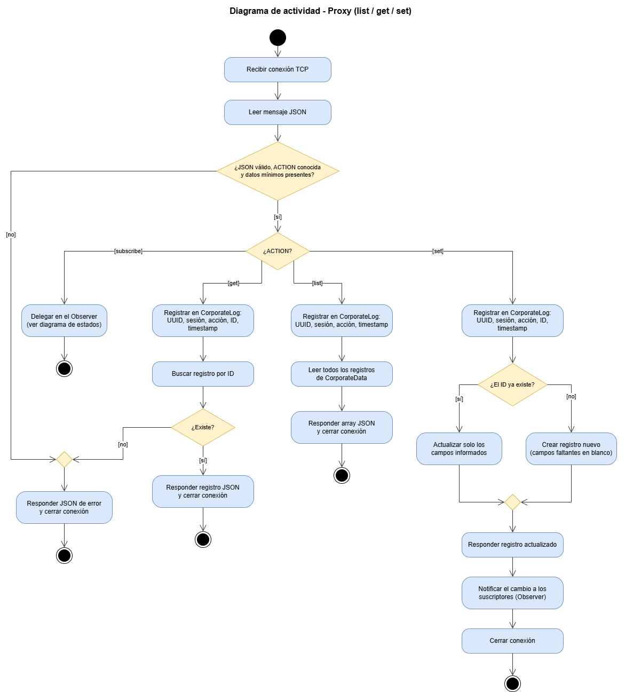
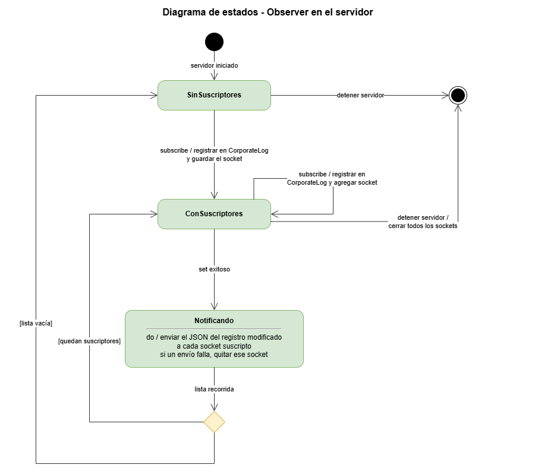

# Diagramas UML

Los diagramas se editan con [draw.io](https://app.diagrams.net/) (archivos `.drawio`).
Las imágenes `.png` son la exportación que se usa en el informe y en este README.

## Diagrama de actividad: proxy (`list`, `get`, `set`)

Toda acción válida se registra en `CorporateLog` **antes** de acceder a
`CorporateData`. Los errores convergen en un nodo de fusión y terminan en una única
respuesta de error. La acción `subscribe` se delega en el Observer.

## Diagrama de estados: Observer en el servidor

Cada `subscribe` agrega un socket a la lista de suscriptores. Cada `set` exitoso
lleva al estado *Notificando*, que envía el registro modificado a todos los
suscriptores y descarta los sockets caídos.

